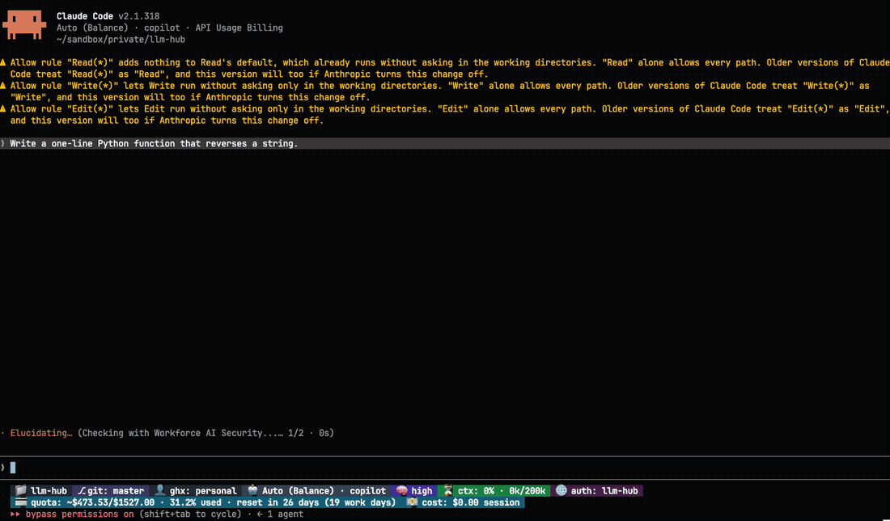
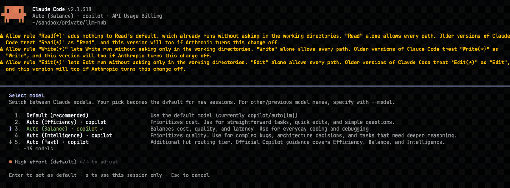
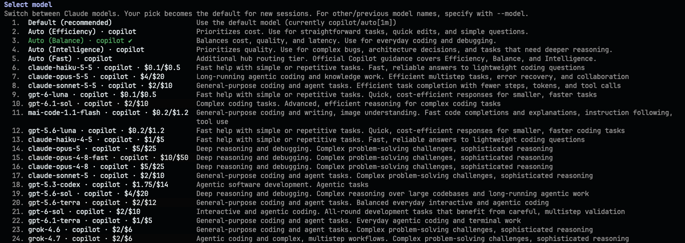
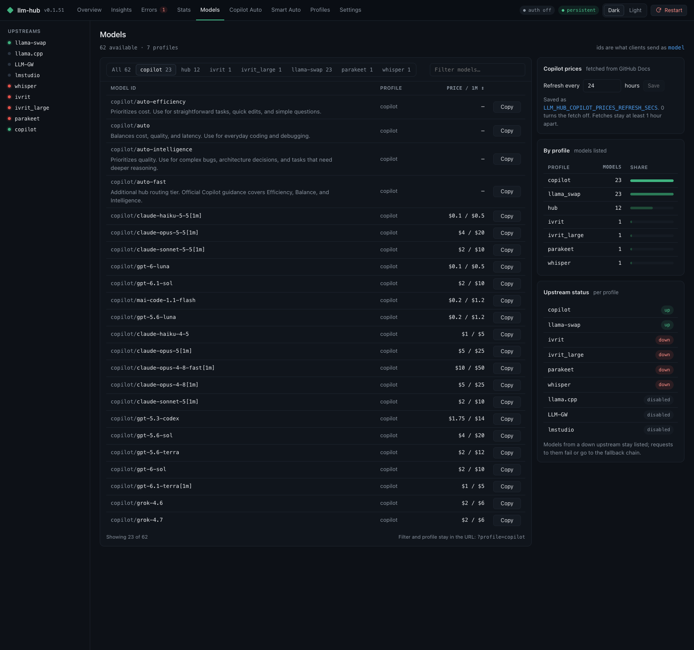

# Use GitHub Copilot in Claude Code, with llm-hub

llm-hub is a small program that runs on your computer. It lets Claude Code use the models you
already have in GitHub Copilot.

Source code: [github.com/barnuri/llm-hub](https://github.com/barnuri/llm-hub).

## Why install it

1. Use your Copilot models in Claude Code, with one command.
2. See the price and a short description of every model, right in the `/model` picker.
3. Let Copilot Auto pick a model per prompt, or pick one yourself with `/model`.
4. Updates arrive on their own.
5. It is open source under the MIT license.

We recommend installing it. Four steps below.

You set it up once. After that, you start Claude Code with one command.



## What you need

1. A GitHub Copilot subscription.
2. Claude Code installed. Check it with `claude --version`.
3. A Mac or Linux computer. For Windows, see the [install guide](../service-and-updates.md#install).

## Install in 4 steps

**Step 1. Install llm-hub.** Paste this in a terminal:

```sh
curl -fsSL https://raw.githubusercontent.com/barnuri/llm-hub/master/scripts/install.sh | sh
```

**Step 2. Make a settings file.** Make a folder, for example `~/llm-hub`. Put a file named `.env`
in it with these two lines:

```sh
LLM_HUB_COPILOT_BASE_URL=https://api.githubcopilot.com
LLM_HUB_COPILOT_AUTH=github-copilot
```

**Step 3. Log in to GitHub.** Run this from the same folder:

```sh
llm-hub copilot login --profile copilot
```

The terminal shows a code and a web address. Open the address, enter the code, and approve.

**Step 4. Start Claude Code on Copilot.** Keep llm-hub running in one terminal (run `llm-hub`
from the folder). In a second terminal, run:

```sh
llm-hub claude copilot/auto
```

Claude Code starts. Type your question as usual. The status line at the bottom shows the model,
the context used, and your Copilot quota. See the [Claude Code guide](claude-cli.md#start-a-session).

## What `copilot/auto` means

Copilot Auto picks a model for each thing you ask. A quick question can use a small, fast model.
A harder task can use a stronger one. You do not choose. See a live example in the
[integration guide](integration.md#copilot-auto-in-practice).

To pick a model yourself, type `/model` inside Claude Code. To list only your Copilot models, start
with `llm-hub --profiles copilot claude copilot/auto`. Each model shows its price and a one-line
description from GitHub Docs.



All 24 entries in one list:



## See the price of each model

llm-hub shows the price per 1 million tokens for each model. Open the **Models** page and pick the
**copilot** tab, or open `http://localhost:8888/models?profile=copilot`.



## Good to know

- **Updates are automatic.** llm-hub checks for a new version when it starts and once a day.
  Set `LLM_HUB_AUTO_UPDATE=false` in `.env` to turn this off.
- **Keep the terminal open.** If llm-hub is not running, Claude Code stops with
  "llm-hub is not reachable". Run `llm-hub service install` to start it in the background.
- **Use it for normal work.** GitHub can block accounts that send heavy automated traffic through
  Copilot outside its own apps. Daily use is fine.

## Next

- [Integration](integration.md): how llm-hub connects to Copilot.
- [Claude Code guide](claude-cli.md): more about `llm-hub claude`.
- [GitHub Copilot reference](../github-copilot.md): every setting.
- [Troubleshooting](../troubleshooting.md): when something breaks.
