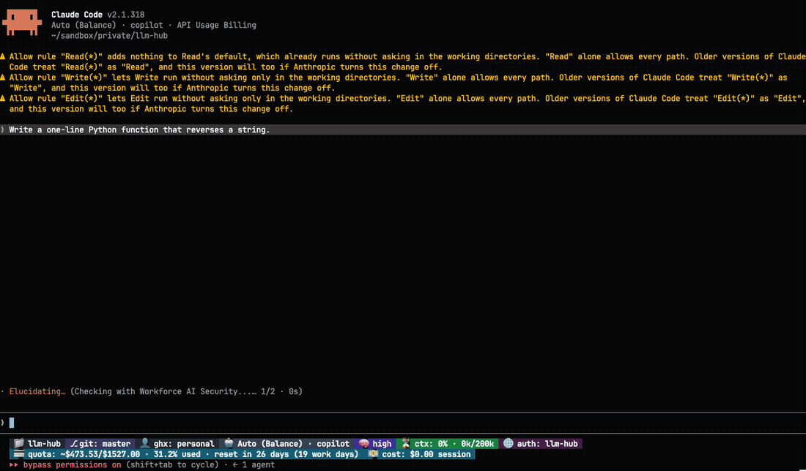
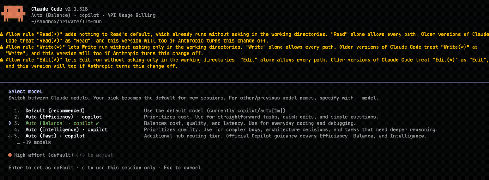
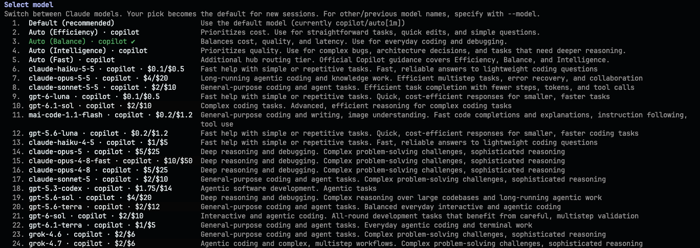

# Claude Code on Copilot

How to start Claude Code through llm-hub, and how to pick a model. For the install steps, see the
[shareable guide](README.md). For the Copilot side, see [integration](integration.md).



## Start a session

Keep llm-hub running. Then, in any project folder:

```sh
llm-hub claude copilot/auto
```

Claude Code opens on Copilot Auto. The status line shows the model, the context used, and the
Copilot quota. It updates as the reply arrives:


| Line | Meaning |
|---|---|
| `Auto (Balance) → gpt-6-luna` | The tier you chose, and the model Copilot Auto picked for this turn. |
| `$0.1/$0.5 per 1M` | Price per 1 million input and output tokens for that model. |
| `ctx: 3% · 28k/872k` | Share of the context window used, and its size. |
| `auth: llm-hub` | The server that Claude Code talks to (`ANTHROPIC_SERVER_NAME`). |
| `quota: … 31.2% used` | Copilot quota used, and when it resets. |
| `cost: $0.06 session` | What this session cost so far. |

## Start on a fixed model

Name the model instead of Auto:

```sh
llm-hub claude copilot/claude-opus-4-5
```

Start with no model to get the default, `hub/smart-auto-balance`:

```sh
llm-hub claude
```

## Pick a model in the session

To list only your Copilot models, add `--profiles copilot` before the agent name:

```sh
llm-hub --profiles copilot claude copilot/auto
```

Then type `/model`. In this example the list has 24 entries: the default, the four Copilot Auto
tiers, and every Copilot model with its price per 1 million tokens (input/output) and a one-line
description from GitHub Docs. The picker shows 5 to 10 rows at a time. Scroll with the arrow keys:



This image joins the five scroll positions into one list:



- **Default** uses the model you started with.
- **Auto (Efficiency)**, **Auto (Balance)**, **Auto (Intelligence)** and **Auto (Fast)** are
  Copilot Auto tiers. Pick the one that fits the job.
- Every other row is one Copilot model, for example `gpt-6-luna`, with its price and a
  description: the task area first, then what the model excels at.

Your pick becomes the default for new sessions.

The descriptions come from GitHub Docs' "AI model comparison" page. The hub fetches it in the
background with the price table, so the picker never waits for GitHub. A model with no row on that
page shows `via llm-hub profile copilot` instead.

How the filter works: `--profiles copilot` adds the header `x-llm-hub-profiles: copilot` to
`ANTHROPIC_CUSTOM_HEADERS`, and the hub lists only that profile's models. Without the flag, the list
also has Smart Auto and the models of every other profile.

## Smart Auto flags

These flags go before the command. They tune how Smart Auto picks:

| Flag | What it does |
|---|---|
| `--smart-auto-tier` | The tier to aim for, for example `balance`. |
| `--smart-auto-min-context` | Only use models with at least this context window. |
| `--smart-auto-min-input` | Only use models that accept at least this input size. |
| `--smart-auto-include` | Only use the models you list. |
| `--smart-auto-exclude` | Never use the models you list. |
| `--smart-auto-role` | The role of the work. Smart Auto lists the roles and their cue words. |

Full details: [Smart Auto](../smart-auto.md#launch-flags).

## What the command sets

`llm-hub claude` points Claude Code at the hub. You do not set these yourself:

| Variable | Value |
|---|---|
| `ANTHROPIC_BASE_URL` | the hub address |
| `ANTHROPIC_AUTH_TOKEN` | your hub key |
| `CLAUDE_CODE_ENABLE_GATEWAY_MODEL_DISCOVERY` | `1`, so the `/model` list fills from the hub |
| `ENABLE_TOOL_SEARCH` | `true` |

Then it runs `claude` with a model list from the hub. If the hub does not answer, Claude Code starts
without that list.

## A shell shortcut

Add your usual flags to every run with a small function. This zsh or bash example keeps the model
first:

```sh
CLAUDE_SHARED_ARGS=(--permission-mode acceptEdits)

cLLMHub() {
    if [ -n "$1" ] && [ "${1#-}" = "$1" ]; then
        local model="$1"; shift
        llm-hub claude "$model" "${CLAUDE_SHARED_ARGS[@]}" "$@"
    else
        llm-hub claude "${CLAUDE_SHARED_ARGS[@]}" "$@"
    fi
}
```

Now `cLLMHub copilot/auto` starts Claude Code on Copilot Auto with your flags.

## When it does not start

- **"llm-hub is not reachable at http://…"**: the hub is not running. Start it with `llm-hub`, or
  run `llm-hub service install` once to keep it running in the background.
- **The `/model` list shows only Claude names**: the list comes from the hub at start. Restart
  `llm-hub claude` while the hub runs. Other models come from the settings list, not from
  discovery.
- **Claude Code compacts the chat too early**: see
  [Troubleshooting](../troubleshooting.md#claude-code-compacts-the-conversation-early).

Full command reference: [Coding agents](../coding-agents.md#llm-hub-claude).
