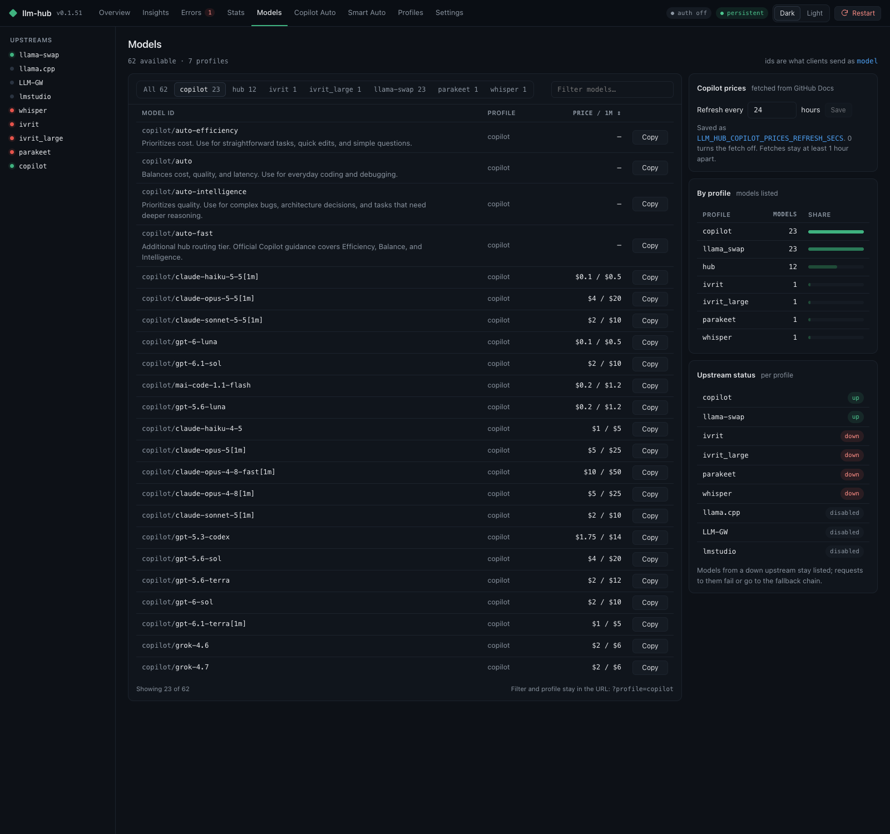
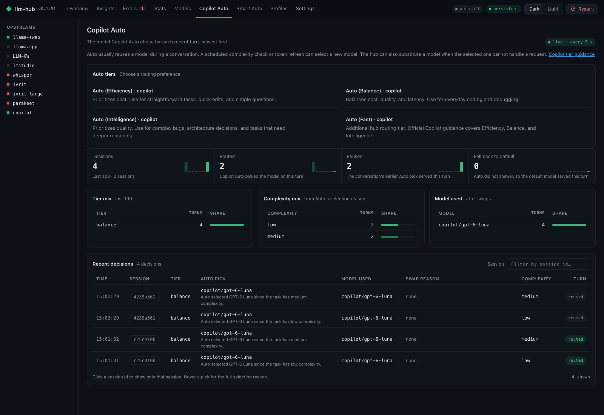

# GitHub Copilot integration

How llm-hub connects to GitHub Copilot, and what that gives you. For the install steps, see the
[shareable guide](README.md). For every setting, see the
[reference](../github-copilot.md).



## The short version

llm-hub logs in to Copilot as you, then serves Copilot's models on a local address. Claude Code,
Codex, opencode and other tools talk to llm-hub. llm-hub talks to Copilot.

```text
Claude Code ──► llm-hub (localhost:8888) ──► GitHub Copilot
                  │
                  └── also: local models, pricing, usage, Smart Auto
```

Nothing sits between llm-hub and Copilot. There is no third-party proxy.

## What you get

1. **One login.** `llm-hub copilot login` uses GitHub's device flow once. The token goes to the OS
   credential store (Keychain on macOS), never to a file.
2. **Copilot models in your tools.** A profile named `copilot` lists its models as
   `copilot/<model>`, for example `copilot/claude-opus-4-5`.
3. **Copilot Auto.** The model `copilot/auto` lets Copilot pick a model for each prompt. See
   [Copilot Auto](../copilot-auto.md).
4. **Prices and descriptions per model.** The Models page shows the price per 1 million tokens.
   Claude Code's `/model` picker shows the price and a one-line description of each model, taken
   from GitHub Docs. The Copilot quota shows in the hub and in the Claude Code status line.
5. **Native Claude routes.** Claude models from Copilot go to Copilot's own `/v1/messages`, so
   thinking blocks and tool use pass through unchanged.

## Two ways to log in

| `AUTH` | What the hub sends to Copilot | Token source |
|---|---|---|
| `github-copilot` | Your GitHub token, as the bearer. The hub reads the API base from `copilot_internal/user`. | `gh` if installed, else `llm-hub copilot login` |
| `github-copilot-vscode` | A short-lived Copilot token, refreshed before it expires. It sends the VS Code headers. | `llm-hub copilot login` only |

Use `github-copilot` for most people. It is the default in the install steps.

## Models you will see

- The hub hides models that Copilot hides and models your policy disables.
- Copilot names Claude models with dots (`claude-opus-4.5`). The hub lists them with dashes
  (`copilot/claude-opus-4-5`). Both forms work in requests.
- Some GPT models only work through Copilot's Responses API. The hub bridges them, so Claude Code
  still works with them.
- The hub learns real prompt limits from Copilot's errors and uses them from then on.
- Each model carries a description: its task area, then what it excels at. The hub reads both from
  GitHub Docs' "AI model comparison" page in the background, on the same timer as the prices
  (`LLM_HUB_COPILOT_PRICES_REFRESH_SECS`, daily by default). A request never waits for GitHub. A
  model with no row on that page keeps the text `via llm-hub profile copilot`.

## What happens on one request

1. Claude Code sends the request to llm-hub with the model `copilot/auto`.
2. On a routing turn, llm-hub asks Copilot which model fits the prompt.
3. llm-hub sends the request to that model and streams the answer back.
4. Follow-up turns in the same conversation keep the same model, so the conversation does not jump
   between models.

## Copilot Auto in practice

A few short test prompts went through `copilot/auto`. The page counts every decision: 4 in 2
sessions here, 2 routed and 2 reused. Copilot picked `gpt-6-luna` each time, for low and medium
complexity tasks. The table shows each decision: the time, the session, the tier, the pick, the
complexity, and whether the turn routed or reused the earlier pick.



## Limits to know

- Heavy automated use outside Copilot's own apps can trigger GitHub's abuse detection. Normal
  daily use is fine.
- Copilot's own rules still apply: premium request limits and model availability depend on your
  plan.

## Related

- [Claude Code guide](claude-cli.md): `llm-hub claude` and the `/model` picker.
- [Shareable guide](README.md): install in four steps.
- [Copilot reference](../github-copilot.md): every setting and header.
- [Copilot Auto](../copilot-auto.md): how Auto routes.
