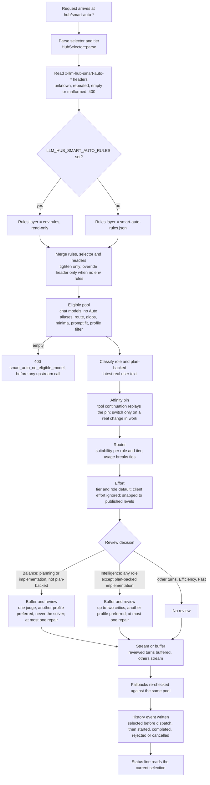

# Smart Auto

## What it is

Smart Auto is one virtual model id, `hub/smart-auto`, that llm-hub resolves to a concrete model on every turn. It keeps a conversation on the model it picked, so the prompt cache stays warm, and it changes model only when the work really changes. On the Balance and Intelligence tiers it can also have another model review the answer before the answer is returned.

```sh
llm-hub claude hub/smart-auto-balance
```

The choice runs in memory. The request path makes no extra network call for it: the model pool, the pins and the usage counts are all held in memory and refreshed in the background.

## Model ids and tiers

| Selector | Meaning |
|---|---|
| `hub/smart-auto` | The default tier, Balance. |
| `hub/smart-auto-<tier>` | One tier: `efficiency`, `balance`, `intelligence` or `fast`. |
| `hub/smart-auto-long[-<tier>]` | The tier, with a total context window of at least 1,000,000 tokens. |
| `hub/smart-auto-long-input[-<tier>]` | The tier, with a prompt capacity of at least 1,000,000 tokens. |
| `hub/<name>` | An operator preset from `LLM_HUB_SMART_AUTO_PRESETS`. |

A selector with no tier, such as `hub/smart-auto-long`, uses Balance. An unknown `hub/*` name returns 400.

Operator presets are a JSON object that maps a name to a policy. Each policy takes the fields `tier`, `include`, `exclude`, `profile_include`, `profile_exclude`, `min_context_tokens`, `min_input_tokens`, `min_output_tokens` and `role`. Unknown fields are rejected:

```sh
LLM_HUB_SMART_AUTO_PRESETS='{"team-long": {"tier": "intelligence", "min_context_tokens": 1000000, "include": [["copilot/*"]], "exclude": ["*preview*"]}}'
```

A preset name may use ASCII letters, digits, `-`, `_` and `.`. A name that starts with `smart-auto` is reserved for the built-in selectors. The profile names `hub` and `HUB` are reserved too, so no profile can shadow the `hub/` namespace.

`/v1/models` lists `hub/smart-auto-balance` first and marks it `recommended: true`. Each `hub/*` entry has `owned_by: "hub"`. Its limit fields are the smallest value across the models in its pool, and a limit is absent when any model in the pool leaves it unknown.

## Flow



The steps in detail:

1. **Headers.** Every `x-llm-hub-smart-auto-*` header is read and then removed, so no upstream sees it. Table in [Headers](#headers).
2. **Rules layer.** If `LLM_HUB_SMART_AUTO_RULES` is set, its JSON is the only rules layer and the saved file is ignored. Otherwise the layer is `smart-auto-rules.json`, kept in the store's directory. A missing file means no rules. Rules have `include`, `exclude` and per-profile `profiles.<name>.include` and `exclude`, all globs over `<profile>/<model>` or the bare model id.
3. **Merge.** Rules, then the selector's policy, then the request's headers are merged with `merge`, which only tightens: excludes union, include lists stack (a model must match one glob of each list), minima take the larger value, and `role` takes the request's value. The tier comes from the selector.
   - `x-llm-hub-smart-auto-rules: override` replaces the rules' include and exclude, and their profile rules, with the request's include and exclude. It takes effect only when no env rules are set.
4. **Eligible pool.** In this order, a model must pass each check:
   1. It is a concrete chat model. Speech models, `hub/*` ids and Copilot Auto aliases (`auto`, `auto-fast`, ...) are never in the pool.
   2. It serves the client route, such as `/v1/messages`. A model that lists no routes serves all of them.
   3. The rules admit it. Checked in order: global exclude, profile exclude, profile include, global include. A deny always wins. `[1m]` on a glob is ignored for matching.
   4. Its known total context, prompt capacity and output capacity meet the minima. An unknown or conflicting value fails any minimum set for it. The local runtime cap applies to both prompt and total context.
   5. The estimated prompt, about one token per four request bytes, does not exceed a known prompt or context ceiling. A lower-bound observation is never a ceiling.
   6. The caller's `x-llm-hub-profiles` filter allows its profile. A filter that names only `hub` leaves the pool unrestricted.
5. **Role and plan-backed.** See [Roles](#roles).
6. **Affinity pin.** See [Affinity and switches](#affinity-and-switches).
7. **Router.** Picks the solver. A pinned conversation keeps its pin. A fresh conversation takes the model it last used for this role if that model is still eligible, else the highest seed score. See [Scoring](#scoring).
8. **Effort.** See [Effort](#effort).
9. **Review decision.** See [Review](#review).
10. **Stream or buffer.** A reviewed answer is held until the review finishes. Every other answer streams. A reply that contains a tool call is returned at once, unreviewed.
11. **Fallbacks.** The `x-llm-hub-fallbacks` chain and the default chain are filtered by the same pool, so a fallback that the policy forbids is never called.
12. **History.** Each dispatch writes a `selected` event before the request is sent, then `started` on a 2xx, then `completed`, `rejected` or `cancelled`. Review adds `judge`, `critic` and `repair` events.
13. **Status line.** The status line shows the current selection of the worker. See [Where to see things](#where-to-see-things).

### Headers

| Header | Value | Effect |
|---|---|---|
| `x-llm-hub-smart-auto-tier` | `efficiency`, `balance`, `intelligence` or `fast` | Parsed into the tier layer. See Open questions: it does not change a `hub/*` selector's tier. |
| `x-llm-hub-smart-auto-include` | Comma-separated globs | Adds an allow-list. Repeated include headers join the same list. |
| `x-llm-hub-smart-auto-exclude` | Comma-separated globs | Removes matching models. Unions with other excludes. |
| `x-llm-hub-smart-auto-min-context` | Tokens, such as `1m` or `200k` | Minimum total context. `1m` is 1,000,000. |
| `x-llm-hub-smart-auto-min-input` | Tokens | Minimum prompt capacity. |
| `x-llm-hub-smart-auto-min-output` | Tokens, such as `32k` | Minimum output capacity. |
| `x-llm-hub-smart-auto-role` | `planning`, `investigation`, `implementation`, `validation` or `conversation` | The work role of the request. It wins over every text rule, and over a preset's role. |
| `x-llm-hub-smart-auto-rules` | `merge` (default) or `override` | Whether the request's include and exclude tighten or replace the saved rules. |
| `x-llm-hub-smart-auto-worker` | An identity, up to 256 characters | Scopes the pin and the history to one worker, such as `<run>/<node>/<attempt>`. |
| `x-llm-hub-smart-auto-parent` | An identity | Groups workers under one workflow in the history. |
| `x-llm-hub-smart-auto-policy` | An identity | A parent policy handle. It is part of the affinity key. It is not an authorization. |

Response headers on a Smart Auto answer: `x-llm-hub-model` (the model that served it, after any review), `x-llm-hub-attempts` (each attempt and its status), `x-llm-hub-smart-auto-tier`, `x-llm-hub-smart-auto-role`, `x-llm-hub-smart-auto-reason` (`fresh`, `pinned`, `incumbent`, `role_switch` or `tool_continuation_replay`), and `x-llm-hub-smart-auto-effort` (absent when the model publishes no levels).

When the pool is empty, the 400 names every active restriction:

```json
{"error": {"message": "smart_auto_no_eligible_model: no model serves hub/smart-auto-balance on /v1/messages under: tier balance, min context 1000000 tokens"}}
```

### Launch flags

The `llm-hub` agent commands take the same policy as flags before the harness name: `--smart-auto-tier`, `--smart-auto-min-context`, `--smart-auto-min-input`, `--smart-auto-include`, `--smart-auto-exclude` and `--smart-auto-role`. The Claude launcher sends them as lines of `ANTHROPIC_CUSTOM_HEADERS`. With no model named, the tier flag picks the `hub/smart-auto-<tier>` id. Other launchers accept only a tier or a one-million minimum, which map to a preset id. An explicit model is never replaced. See [Coding agents](coding-agents.md).

### Roles

The role is read from the latest real user text. System reminders are stripped, and instructions inside the text are treated as data.

- The earliest cue word in the text decides the role. Planning cues: `plan`, `planning`, `design`, `architecture`, `spec`, `specs`, "how should we/I". Investigation cues: `why`, `investigate`, `find`, `debug`, `diagnose`, `logs`, `search`, "root cause". Implementation cues: `implement`, `write`, `fix`, `add`, `refactor`. Validation cues: `test`, `tests`, `review`, `verify`, `check`.
- Text with no cue is implementation when it has a plan marker, and conversation otherwise. Empty text is conversation.
- A plan marker is `plan.md`, `tasks.md`, `agent-spec/`, a `<command-name>` tag or a leading lowercase `/skill` token. A marker makes the turn plan-backed. A plan word in the system prompt does not count.
- A caller's `role` header or a preset's role wins over every rule, and still sets plan-backed from the text.
- A tool continuation (a tool result with no new user text) keeps the pinned role and plan backing.

### Affinity and switches

The hub keeps one pin per conversation, and it remembers the model it used for each role.

- **The key.** The conversation anchor is the first of: the Claude Code session header (`x-claude-code-session-id`), the `prompt_cache_key`, a hash of the system prompt and first user message, or the worker header. The key also hashes the worker, parent and policy headers, the endpoint and the restrictions in force (tier and globs). A change of filters therefore starts a new key.
- **Lookup.** A pin is returned only while its model is still in the pool. An ineligible pin is dropped.
- **Tool continuation.** It replays the pin, with reason `tool_continuation_replay`. No role is classified and no switch is considered.
- **Switch.** A turn may move the pin only when the work changes weight. Weights: conversation is light, plan-backed implementation is cheap, and implementation, planning, investigation and validation are heavy. A switch needs a weight change to a non-light weight. A conversation turn never moves the pin.
- **Budget.** An optional switch needs the pin to have been held for at least 2 user turns, and fewer than 2 switches in the last 20 user turns.
- **Commit.** The pin is recorded only after a 2xx response whose stream completed without error.
- **Limits.** At most 1,024 conversations. A conversation idle for 10 minutes is dropped. Pins live in memory and are not restored after a restart.

### Scoring

Among eligible models, the router takes the highest score, then the most usage points, then the lowest qualified id.

- **Seed table.** Built-in family seeds give quality per role column (planning, investigation, implementation, plan-backed implementation, validation, conversation), plus cheapness and speed, all 0 to 10. A family the table does not know gets average seeds (5 for quality, 3 for cheapness and speed).
- **Tier weights.** Efficiency: quality 1, cheapness 4, speed 1. Balance: quality 5, cheapness 2, speed 1. Intelligence: quality 6, cheapness 0, speed 1. Fast: quality 1, cheapness 1, speed 4.
- **Capable bonus.** A model whose role quality is at least 5 gets +1000, so every capable model outranks every other one.
- **Usage.** The 30-day request count per model gives 0 points below 256 requests, 1 below 65,536, and 2 above. Usage separates only near ties.

Ranking uses these built-in seeds and the usage counts. It does not use measured latency or quality.

### Effort

The hub writes one effort into the body of each routed request, in the field of the client route: `reasoning_effort` (chat completions), `reasoning.effort` (responses) or `output_config.effort` (messages).

- **The client's effort is ignored** on Smart Auto routes. The hub picks the effort from the tier and role.
- **Objective.** Efficiency and Fast aim for low. Balance aims for low on plan-backed implementation and medium otherwise. Intelligence aims for medium on plan-backed implementation, high for planning, investigation and implementation, and medium for validation and conversation.
- **Snap.** The objective is snapped to the nearest level that the model publishes, with ties going to the higher level. The hub never sends `none`.
- **No levels.** A model that publishes no levels gets no effort field. A fallback model gets the same objective, snapped to its own levels.

## Review

Review runs only on the chat-completions path (`/v1/chat/completions` and `/v1/messages`). A `/v1/responses` request is served as one stream and not reviewed. An answer that a native Anthropic upstream serves is not reviewed either.

| Step | What happens |
|---|---|
| Solver | The routed model answers, non-streaming while review is planned. |
| Tool call | Returned at once, unreviewed. |
| Judges or critics | Reviewers run in parallel. Balance uses one judge. Intelligence uses up to two critics. Reviewers come from the same pool and rules, must fit the request's estimated prompt, and never include the solver. Another profile is preferred, not required. |
| Verdict | `accept`, `repair` (with issues) or `reject` (with issues). |
| Repair | At most one repair call, by the solver model, with the issues the reviewers named. |
| Reject | The draft is not sent. The client gets an error, and no repair or fallback follows. |

Each review stage has a budget:

| Tier | Model calls | Tokens | Bytes | Total time | Per stage |
|---|---|---|---|---|---|
| Balance | 3 | 64,000 | 256 KiB | 120 s | 60 s |
| Intelligence | 4 | 128,000 | 512 KiB | 240 s | 90 s |

A stage that runs out of budget, times out or returns a malformed verdict leaves the draft as the answer. Reviewers on a single-resident managed profile run one call at a time.

## Tiers

| Tier | Optimises | Review | Buffering |
|---|---|---|---|
| `efficiency` | Cost: the cheapest capable model. | None. | Streams. |
| `balance` (default) | A role fit between cost and quality. | One judge on planning and implementation turns, skipped for plan-backed implementation. Other roles are not reviewed. | Only reviewed turns are buffered. |
| `intelligence` | Quality: the strongest role-fit model. | Up to two critics on every role except plan-backed implementation. | Buffered, except plan-backed implementation, which streams. |
| `fast` | Latency: the capable model with the best speed seed. | None. | Streams. |

## Where to see things

- **Smart Auto tab in the UI.** The panels are:
  - *Current selection*: the worker's current model and its active stages.
  - *Rules*: global include and exclude, per-profile rules, and a results table that shows each known model's outcome and the glob that decided it.
  - *Stage and turn timeline*: the history, newest first, with salted keys.
  - *How Smart Auto works*: a summary of the request path, tiers and where to see things.
- **Status line.** The status line shows the current selection. The consumer of `/api/smart-auto/current` is not in this repository, so this doc does not name the code that reads it.
- **HTTP routes.** All of these need a key when hub auth is on.
  - `GET /api/smart-auto/current?worker=<id>` or `?session=<id>`: the worker's main model, its active stages, `age_ms` and `stale` (after 10 minutes). `selection` is `null` before the first event. Returns 400 without either parameter.
  - `GET /api/smart-auto/history?workflow=&worker=&since_seq=&limit=`: events after `since_seq`, oldest first. `limit` defaults to 200 and is capped at 1,000.
  - `GET /api/smart-auto/decisions?limit=N`: the newest routes, newest first, from memory. `limit` defaults to 50 and is capped at 200.
  - `GET /api/smart-auto/rules`: the active rules, their source (`file`, `env` or `none`) and whether they are read-only.
  - `PUT /api/smart-auto/rules`: validates the JSON, saves it atomically and makes it active. Refused when env rules own the rules.
  - `GET /api/smart-auto/rules/effect`: each known model's outcome under the current rules, with the reason and the glob that decided it.

### Privacy and storage

An event holds salted scope keys and metadata: selector, tier, role, stage, model, state, reason, effort, status, latency and token counts. It never holds prompt, response or tool text. The salt is random per install and kept in the store, so a stored key does not reveal the id it stands for.

- Events are saved to the store (`LLM_HUB_STORE`, SQLite by default) by a writer thread. A full writer queue drops the save, not the in-memory event.
- The store keeps the newest 10,000 events and events from the last 14 days. Memory holds the newest 2,000.
- On start the hub reloads the newest events from the store. Current selections and pins start empty.

Set `LLM_HUB_STORE_PATH` to choose the store file. See [Configuration](configuration.md).

## Safety rules

- **Deny wins.** A model that matches any exclude glob is out, even when an include matches it. Global and profile excludes are checked before any include. Fallbacks follow the same pool, so a forbidden fallback is never called.
- **A request can narrow the rules.** Its include and exclude only add restrictions in the default `merge` mode.
- **A request can widen them only in override mode, and only when no env rules are set.** `x-llm-hub-smart-auto-rules: override` replaces the saved include and exclude, and the profile rules, for that request. With `LLM_HUB_SMART_AUTO_RULES` set, override has no effect.
- **Fail closed on unknown limits.** A model with an unknown or conflicting total, prompt or output capacity fails any minimum set for it. An unknown header, a repeated single-value header or an empty value returns 400.
- **Tier names do not widen the pool.** A tier only changes scoring and review. It never admits a model that the rules or minima exclude.

## Open questions

- **Tier header on a `hub/*` selector.** `SmartAutoPolicy::merge` keeps the earlier tier, and every `hub/*` selector sets one. A request's `x-llm-hub-smart-auto-tier` therefore looks like it cannot change the tier of `hub/smart-auto-balance`. The Claude launcher sends `--smart-auto-tier=fast` as this header on a named `hub/smart-auto-balance` (`src/services/launch/claude_launcher.rs`, test `smart_auto_flags_follow_the_profiles_header`). I read this from the code and did not run it. Check whether the tier flag is meant to work with a named model.
- **Fast tier comment.** The code comment in `src/schemas/smart_auto_tier.rs` says "lowest measured latency", but the router uses the built-in speed seed and no measurement. This doc describes the seed.
- **Status line consumer.** The UI text says the status line shows the current selection. I found no code in this repository that reads `/api/smart-auto/current` for the status line.
- **Rejected review status.** A rejected draft becomes `AppError::UpstreamUnavailable`. I did not check the HTTP status code that error maps to.
