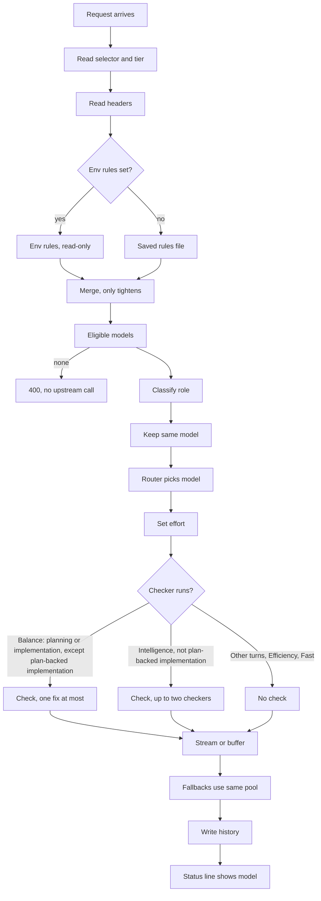

# Smart Auto

## What it is

Smart Auto is one virtual model id: `hub/smart-auto`. On every turn, llm-hub turns it into a real model.

It keeps a chat on the same model, so the prompt cache stays warm. It switches models only when the work really changes. On the Balance and Intelligence tiers, a second model can also check the answer before it is returned. That second model is a **checker**.

```sh
llm-hub claude hub/smart-auto-balance
```

All choices happen in memory. The request path makes no extra network call. The model pool, the kept models and the usage counts sit in memory. A background task refreshes them.

## Model ids and tiers

| Selector | Meaning |
|---|---|
| `hub/smart-auto` | The default tier, Balance. |
| `hub/smart-auto-<tier>` | One tier: `efficiency`, `balance`, `intelligence` or `fast`. |
| `hub/smart-auto-long[-<tier>]` | The tier, with a total context window of at least 1,000,000 tokens. |
| `hub/smart-auto-long-input[-<tier>]` | The tier, with room for at least 1,000,000 prompt tokens. |
| `hub/<name>` | An operator preset from `LLM_HUB_SMART_AUTO_PRESETS`. |

A selector with no tier, like `hub/smart-auto-long`, uses Balance. An unknown `hub/*` name returns 400.

Operator presets are JSON. Each preset maps a name to a policy. A policy takes these fields: `tier`, `include`, `exclude`, `profile_include`, `profile_exclude`, `min_context_tokens`, `min_input_tokens`, `min_output_tokens` and `role`. Unknown fields are rejected.

```sh
LLM_HUB_SMART_AUTO_PRESETS='{"team-long": {"tier": "intelligence", "min_context_tokens": 1000000, "include": [["copilot/*"]], "exclude": ["*preview*"]}}'
```

A preset name can use ASCII letters, digits, `-`, `_` and `.`. Names that start with `smart-auto` are reserved for the built-in ids. The profile names `hub` and `HUB` are reserved too, so no profile can take the `hub/` namespace.

`/v1/models` lists `hub/smart-auto-balance` first, marked `recommended: true`. Each `hub/*` entry has `owned_by: "hub"`. Its limit fields hold the smallest value across its pool. A limit is left out when any model in the pool does not know it.

## Flow



The steps:

1. **Headers.** Every `x-llm-hub-smart-auto-*` header is read, then removed. No upstream sees it. The table is in [Headers](#headers).
2. **Rules layer.** If `LLM_HUB_SMART_AUTO_RULES` is set, its JSON is the only rules layer. The saved file is ignored. Otherwise the layer is `smart-auto-rules.json`, in the store's directory. No file means no rules. Rules have `include`, `exclude`, and per-profile `profiles.<name>.include` and `exclude`. All are globs over `<profile>/<model>` or the bare model id.
3. **Merge.** Rules, then the selector's policy, then the headers. `merge` only tightens. Excludes add up. Include lists stack, so a model must match one glob in each list. Minimums take the larger value. `role` takes the request's value. The tier comes from the selector, unless the `x-llm-hub-smart-auto-tier` header names one: the header wins.
   - `x-llm-hub-smart-auto-rules: override` swaps the saved include, exclude and profile rules for the request's include and exclude. It works only when no env rules are set.
4. **Eligible pool.** The pool is the set of models allowed for this request. A model must pass each check, in order:
   1. It is a concrete chat model. Speech models, `hub/*` ids and Copilot Auto aliases (`auto`, `auto-fast`, ...) never count.
   2. It serves the client route, such as `/v1/messages`. A model that lists no routes serves all of them.
   3. The rules allow it. The order is: global exclude, profile exclude, profile include, global include. A deny always wins. `[1m]` on a glob is ignored for matching.
   4. Its known total context, prompt size and output size meet the minimums. An unknown or conflicting value fails any minimum set for it. The local runtime cap applies to prompt and total context.
   5. The estimated prompt, about one token per four request bytes, fits any known prompt or context limit. A lower-bound observation is never a limit.
   6. The caller's `x-llm-hub-profiles` filter allows its profile. A filter that names only `hub` leaves the pool open.
5. **Role and plan-backed.** See [Roles](#roles).
6. **Keep same model.** See [Affinity and switches](#affinity-and-switches).
7. **Router.** Picks the model that answers. A session with a kept model keeps it. A new session takes the model it last used for this role, if that model is still eligible. Otherwise the highest seed score wins. See [Scoring](#scoring).
8. **Effort.** See [Effort](#effort).
9. **Review decision.** See [Review](#review).
10. **Stream or buffer.** A checked answer is held until the check ends. Every other answer streams. A reply with a tool call goes out at once, unchecked.
11. **Fallbacks.** The `x-llm-hub-fallbacks` chain and the default chain use the same pool. A fallback the policy forbids is never called. After them the hub adds up to two more models from the pool, best score first, so a pick that hangs or fails is answered inside the same request. See [Live signals](#live-signals).
12. **History.** Each dispatch writes a `selected` event before the request is sent. Then it writes `started` on a 2xx, then `completed`, `rejected` or `cancelled`. Checks add `judge`, `critic` and `repair` events.
13. **Status line.** Shows the worker's current model. See [Where to see things](#where-to-see-things).

### Headers

| Header | Value | Effect |
|---|---|---|
| `x-llm-hub-smart-auto-tier` | `efficiency`, `balance`, `intelligence` or `fast` | Overrides the tier the `hub/*` selector or preset names. Other headers only tighten. |
| `x-llm-hub-smart-auto-include` | Comma-separated globs | Adds an allow-list. Repeated headers join the same list. |
| `x-llm-hub-smart-auto-exclude` | Comma-separated globs | Removes matching models. Adds to other excludes. |
| `x-llm-hub-smart-auto-min-context` | Tokens, such as `1m` or `200k` | Minimum total context. `1m` is 1,000,000. |
| `x-llm-hub-smart-auto-min-input` | Tokens | Minimum prompt size. |
| `x-llm-hub-smart-auto-min-output` | Tokens, such as `32k` | Minimum output size. |
| `x-llm-hub-smart-auto-role` | `planning`, `investigation`, `implementation`, `validation` or `conversation` | The role of the request. Beats every text rule and a preset's role. |
| `x-llm-hub-smart-auto-rules` | `merge` (default) or `override` | Whether the request's include and exclude narrow or replace the saved rules. |
| `x-llm-hub-smart-auto-worker` | An identity, up to 256 characters | Limits the kept model and history to one worker, such as `<run>/<node>/<attempt>`. |
| `x-llm-hub-smart-auto-parent` | An identity | Groups workers under one workflow in history. |
| `x-llm-hub-smart-auto-policy` | An identity | A parent policy handle. Part of the key that keeps a session on one model. Not an authorization. |

Response headers on a Smart Auto answer:

- `x-llm-hub-model`: the model that served the answer, after any check.
- `x-llm-hub-attempts`: each attempt and its status.
- `x-llm-hub-smart-auto-tier` and `x-llm-hub-smart-auto-role`.
- `x-llm-hub-smart-auto-reason`: `fresh`, `pinned`, `incumbent`, `role_switch` or `tool_continuation_replay`.
- `x-llm-hub-smart-auto-effort`: missing when the model publishes no levels.

When no model is eligible, the 400 names every active restriction:

```json
{"error": {"message": "smart_auto_no_eligible_model: no model serves hub/smart-auto-balance on /v1/messages under: tier balance, min context 1000000 tokens"}}
```

### Launch flags

The `llm-hub` agent commands take the same settings as flags, placed before the harness name: `--smart-auto-tier`, `--smart-auto-min-context`, `--smart-auto-min-input`, `--smart-auto-include`, `--smart-auto-exclude` and `--smart-auto-role`.

The Claude launcher sends them as lines in `ANTHROPIC_CUSTOM_HEADERS`. If no model is named, the tier flag picks `hub/smart-auto-<tier>`. Other launchers take only a tier or a one-million minimum. Those map to a preset id. An explicit model is never replaced. See [Coding agents](coding-agents.md).

### Roles

The role comes from the latest real user text. System reminders are removed. Instructions inside the text are treated as data.

- The earliest cue word in the text sets the role.
  - Planning cues: `plan`, `planning`, `design`, `architecture`, `spec`, `specs`, "how should we/I".
  - Investigation cues: `why`, `investigate`, `find`, `debug`, `diagnose`, `logs`, `search`, "root cause".
  - Implementation cues: `implement`, `write`, `fix`, `add`, `refactor`.
  - Validation cues: `test`, `tests`, `review`, `verify`, `check`.
- Text with no cue is implementation if it has a plan marker. Otherwise it is conversation. Empty text is conversation.
- A plan marker is `plan.md`, `tasks.md`, `agent-spec/`, a `<command-name>` tag, or a leading lowercase `/skill` token. A marker makes the turn **plan-backed**. A plan word in the system prompt does not count.
- The caller's `role` header or a preset's role beats every rule. It still sets plan-backed from the text.
- A tool continuation (a tool result with no new user text) keeps the kept role and plan flag.

### Affinity and switches

The hub keeps one kept model per conversation. It also remembers the model used for each role.

- **The key.** The conversation id is the first of: the Claude Code session header (`x-claude-code-session-id`), the `prompt_cache_key`, a hash of the system prompt and first user message, or the worker header. The key also hashes the worker, parent and policy headers, the endpoint and the active restrictions (tier and globs). Changing a filter starts a new key.
- **Lookup.** A kept model is used only while it is still in the pool. An ineligible one is dropped.
- **Tool continuation.** Replays the kept model, with reason `tool_continuation_replay`. No role is classified and no switch is considered.
- **Switch.** A turn can move to another model only when the work changes weight. Conversation is light. Plan-backed implementation is cheap. Implementation, planning, investigation and validation are heavy. A switch needs a change to a non-light weight, with one exception: a heavy kept model steps down to the conversation pick on a plain conversation turn (no role cue) of more than 3 words, so a premium model does not keep running chat and its tool loops. A short approval ("yes, go") keeps the kept model. A tool continuation never switches, so a tool loop keeps its prompt cache and its signed thinking blocks.
- **Budget.** An optional switch needs the kept model held for at least 2 user turns. It also needs fewer than 2 switches in the last 20 user turns. It also needs a cold cache: no switch while the kept model was used in the last 5 minutes, because a switch would rebuild the whole prompt cache on the new model (measured 32% cache hit on a switch, 95% on a stay).
- **Commit.** The kept model is saved only after a 2xx response whose stream finished without error.
- **Limits.** Up to 1,024 conversations. A conversation idle for 10 minutes is dropped. Kept models live in memory and are not restored after a restart.

### Scoring

Among eligible models, the router picks the highest score. Ties go to the most usage points, then to the lowest qualified id.

- **Seed table.** Built-in family seeds give a quality score for each role (planning, investigation, implementation, plan-backed implementation, validation, conversation). They also give cheapness and speed. All are 0 to 10. A family the table does not know gets average seeds: 5 for quality, 3 for cheapness and speed.
- **Tier weights.**
  - Efficiency: quality 1, cheapness 4, speed 1.
  - Balance: quality 5, cheapness 2, speed 1.
  - Intelligence: quality 6, cheapness 0, speed 1.
  - Fast: quality 1, cheapness 1, speed 4.
- **Capable bonus.** A model whose role quality is at least 5 gets +1000. So every capable model beats every other one.
- **Usage.** The 30-day request count gives 0 points below 128 requests, 1 point below 32,768, and 2 points above. Usage only separates near ties.

The seeds are the starting point. [Live signals](#live-signals) replace the cost and speed seeds with what the hub measured, and take points off for failures and a low quota.

### Live signals

The seed table cannot know that a model is down, slow today, dear on this account, or on a profile that is running out of quota. The hub measures these four things in memory and feeds them into the same score. None of them adds a network call, a process or a disk read to the request path.

| Signal | Measured from | Effect on the score |
|---|---|---|
| Cost | The price book: configured rates, published Copilot rates and rates an upstream lists. Blended as three parts input to one part output, in USD per million tokens. | Replaces the seed cheapness: 10 for a local or sub-$0.10 model, 0 above $100. A model with no known price keeps its seed. |
| Speed | Time to the first byte of each streamed answer, averaged with recent answers weighted most. Needs 3 samples, and a sample goes stale after 30 minutes. | Replaces the seed speed with two parts measured to one part seed. Scores run from 10 (under 1 s) to 0 (over 20 s). Buffered answers are not counted, because their first byte is the whole answer. |
| Error rate | The share of recent attempts that failed on the model's side: a timeout, a transport error, 404, 408, 429 or 5xx. Needs 5 attempts. | Takes off 100 points at a 100% rate, so 5% costs 5 points. A 400, 401, 403 or 422 describes the request or the account and is not counted. |
| Quota | The cached quota of the model's profile (Copilot, Bifrost). A snapshot older than an hour is ignored. | Nothing above 30% left. Below that, 1 point per percent, up to 30. |

One further rule keeps a broken model out of the pool, not just lower in the ranking:

- **Cooldown.** A failed attempt cools the model on that route for 30 seconds. Each failure in a row doubles the wait, up to 10 minutes. An answer clears it. The model rejoins the pool when the wait ends, so the next request tests it.

A quota only costs points. It applies to every model of the profile, because the hub cannot tell which models a quota meters. A metered model that the upstream refuses is cooled by its own error.

A cooled model is also dropped from the fallback chain and from the checker candidates. If every model would be dropped, the pool is left whole: a model that may fail beats a certain 400. A kept model that cools leaves the pool, so its conversation moves to a fresh pick.

The marks are per route (`/v1/messages`, `/v1/chat/completions`, ...), because a model can lack one route and serve the others. Nothing is stored: a restart clears every mark and sample.

**First-byte limit.** A streamed Smart Auto attempt on a remote profile must send its first byte within `LLM_HUB_FIRST_BYTE_TIMEOUT_MS` (20 seconds by default, `0` turns it off). A silent model gets a `timeout`, is cooled, and the next fallback runs. When the chain has no fallback left, the hub tries the next best models of the same pool, at most two: the first from another profile when the pool has one (a gateway that hangs usually hangs for all its models), then the best of the rest by the same score. The limit does not apply to buffered turns (a checked answer, or a client that did not ask to stream), to local servers (managed, or on this machine) that may be loading, or to a request that sets `x-llm-hub-timeout-ms`, which wins. A profile with a shorter `LLM_HUB_<NAME>_TIMEOUT_MS` keeps it. Only the first chunk is held back, so a healthy stream is not delayed.

See what the hub measured with `GET /api/smart-auto/health`.

### Effort

The hub writes one effort into each routed request body. It goes in the field for the client route: `reasoning_effort` (chat completions), `reasoning.effort` (responses) or `output_config.effort` (messages).

- **The client's effort is ignored** on Smart Auto routes. The hub picks it from the tier and role.
- **Target.**
  - Efficiency and Fast aim for low.
  - Balance aims for low on plan-backed implementation, and medium otherwise.
  - Intelligence aims for medium on plan-backed implementation, high for planning, investigation and implementation, and medium for validation and conversation.
- **Snap.** The target snaps to the nearest level the model publishes. Ties go to the higher level. The hub never sends `none`.
- **No levels.** A model that publishes no levels gets no effort field. A fallback gets the same target, snapped to its own levels.

## Review

Checks run only on chat completions (`/v1/chat/completions` and `/v1/messages`). A `/v1/responses` request is served as one stream and is not checked. An answer from a native Anthropic upstream is not checked either.

| Step | What happens |
|---|---|
| Answer | The routed model answers. It does not stream while a check is planned. |
| Tool call | Returned at once, unchecked. |
| Checkers | Run in parallel. Balance uses one checker. Intelligence uses up to two. Checkers come from the same pool and rules, must fit the request's estimated prompt, and never include the answering model. Another profile is preferred, not required. |
| Verdict | `accept`, `repair` (with issues) or `reject` (with issues). |
| Fix | At most one repair call, by the answering model, using the issues the checkers named. |
| Reject | The draft is not sent. The client gets an error. No fix or fallback follows. |

Each check has a budget:

| Tier | Model calls | Tokens | Bytes | Total time | Per stage |
|---|---|---|---|---|---|
| Balance | 3 | 64,000 | 256 KiB | 120 s | 60 s |
| Intelligence | 4 | 128,000 | 512 KiB | 240 s | 90 s |

If a check runs out of budget, times out or returns a bad verdict, the draft is sent as the answer. Checkers on a single-resident managed profile run one call at a time.

## Tiers

| Tier | Optimises | Review | Buffering |
|---|---|---|---|
| `efficiency` | Cost: the cheapest capable model. | None. | Streams. |
| `balance` (default) | Cost and quality, matched to the role. | One checker on planning and implementation turns. Skipped for plan-backed implementation. Other roles are not checked. | Only checked turns are buffered. |
| `intelligence` | Quality: the strongest model for the role. | Up to two checkers on every role except plan-backed implementation. | Buffered, except plan-backed implementation, which streams. |
| `fast` | Speed: the capable model with the best speed seed. | None. | Streams. |

## Where to see things

- **Smart Auto tab in the UI.** The panels are:
  - *Current selection*: the worker's current model and its active stages.
  - *Rules*: global include and exclude, per-profile rules, and a results table. The table shows each known model's outcome and the glob that decided it.
  - *Stage and turn timeline*: the history, newest first, with salted keys.
  - *How Smart Auto works*: a summary of the request path, tiers and where to see things.
- **Status line.** Shows the current model. The code that reads `/api/smart-auto/current` is not in this repository, so this doc does not name it.
- **HTTP routes.** All need a key when hub auth is on.
  - `GET /api/smart-auto/current?worker=<id>` or `?session=<id>`: the worker's main model, its active stages, `age_ms`, and `stale` (true after 10 minutes). `selection` is `null` before the first event. Returns 400 without either parameter.
  - `GET /api/smart-auto/history?workflow=&worker=&since_seq=&limit=`: events after `since_seq`, oldest first. `limit` defaults to 200 and is capped at 1,000.
  - `GET /api/smart-auto/decisions?limit=N`: the newest routes first, from memory. `limit` defaults to 50 and is capped at 200.
  - `GET /api/smart-auto/health`: each `(model, route)` the hub attempted, with `failures` in a row, `last_failure`, `cooled_for_ms` (above 0 means skipped), `error_rate`, `outcomes`, `ttft_ms`, `samples` and `speed`. `costs` holds the cost score of each priced model.
  - `GET /api/smart-auto/rules`: the active rules, their source (`file`, `env` or `none`), and whether they are read-only.
  - `PUT /api/smart-auto/rules`: checks the JSON, saves it atomically and makes it active. Refused when env rules own the rules.
  - `GET /api/smart-auto/rules/effect`: each known model's outcome under the current rules, with the reason and the glob that decided it.
  - `POST /api/smart-auto/resolve`: a dry run. It builds the same pool and policy as a `hub/smart-auto-<tier>` turn on `/v1/messages` and returns the pick, without an upstream call and without writing affinity, history or decisions. Body fields, all optional: `tier` (default `balance`), `role`, `worker`, `session`, `include` and `exclude` (glob lists), `min_context` (tokens) and `text` (user text for role classification). With `worker` or `session`, a kept pin is reported. Reply: `{"model", "tier", "role", "plan_backed", "effort", "reason", "pinned", "alternatives"}`, where `alternatives` holds up to 4 other eligible models, best first. An unknown tier or role returns 400. An empty pool returns 409.
  - `GET /api/smart-auto/tiers`: `{"default_tier", "tiers": [{"name", "selector", "pool"}], "roles", "role_tier_defaults"}`. `pool` lists the models eligible for the tier under the current rules. `role_tier_defaults` maps each role to a suggested tier for clients. The hub does not apply it.

### Privacy and storage

An event holds salted scope keys and metadata: selector, tier, role, stage, model, state, reason, effort, status, latency and token counts. A solver event also holds `affinity_scope` (which part formed the affinity key: `session_header`, `prompt_cache_key`, `content_hash` or `worker_header`) and, on a `fresh` route, `pin_miss` (why no kept model applied: `no_key`, `no_pin`, `idle_expired` or `left_pool`). Both are codes, never raw values. It never holds prompt, response or tool text. The salt is random per install and kept in the store. A stored key does not reveal the id it stands for.

- Events are saved to the store (`LLM_HUB_STORE`, SQLite by default) by a writer thread. If the writer queue is full, the save is dropped. The in-memory event is kept.
- The store keeps every event from the last 60 days, with no count limit. Memory holds the newest 2,000.
- On start, the hub reloads the newest events from the store. Current selections and kept models start empty.

Set `LLM_HUB_STORE_PATH` to choose the store file. See [Configuration](configuration.md).

## Safety rules

- **Deny wins.** A model that matches any exclude is out, even if an include matches it. Global and profile excludes run before any include. Fallbacks use the same pool, so a forbidden fallback is never called.
- **A request can narrow the rules.** In the default `merge` mode, its include and exclude only add restrictions.
- **A request can widen them only in override mode, and only with no env rules.** Override replaces the saved include, exclude and profile rules for that request. With `LLM_HUB_SMART_AUTO_RULES` set, override does nothing.
- **Images need vision.** A request with an image anywhere in its body (any turn, tool results included) keeps only models that report vision. Models with unknown vision support, such as local servers, are left out. A model that answers 500 "image input is not supported" is marked text-only in memory until restart.
- **Chain gates.** Every attempt in the chain (Smart Auto and direct fallbacks) skips a model that cannot read the request's image, or whose known prompt limit is below the estimated prompt size. Unknown limits are still tried. When no model is left, the hub returns 400 at once, naming each model and the reason, with no upstream call.
- **Copilot Auto is chat only.** `copilot/auto` on a path other than chat completions, responses or messages (for example `count_tokens`) returns 400 and asks for a concrete model.
- **Unknown limits fail closed.** A model with an unknown or conflicting total, prompt or output size fails any minimum set for it. An unknown header, a repeated single-value header or an empty value returns 400.
- **Tier names never widen the pool.** A tier only changes scoring and checks. It never admits a model that the rules or minimums exclude.

## Open questions

- **Fast tier comment.** The comment in `src/schemas/smart_auto_tier.rs` says "lowest measured latency". The router uses the built-in speed seed and no measurement. This doc describes the seed.
- **Status line consumer.** I found no code in this repository that reads `/api/smart-auto/current` for the status line.
- **Rejected check status.** A rejected draft becomes `AppError::UpstreamUnavailable`. I did not check which HTTP status that maps to.
